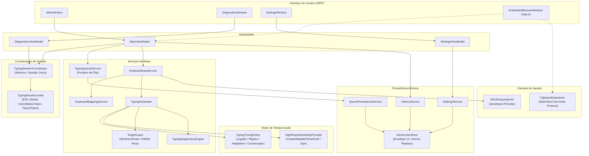

# Arquitetura do VmTyper (v2)

Este documento descreve a arquitetura interna do VmTyper, seus componentes principais, contratos de serviço, fluxo de sessão e formatos de persistência.

---

## 1. Visão Geral dos Componentes

O VmTyper é estruturado em camadas desacopladas orientadas por contratos (interfaces), permitindo teste unitário rigoroso de todo o pipeline de planejamento, temporização, injeção e supervisão de destino sem dependência do ambiente gráfico real.



---

## 2. Fluxo de uma Sessão de Digitação

O ciclo de vida de uma sessão garante que no máximo **uma** injeção ocorra concorrentemente em todo o processo, que o destino em primeiro plano permaneça travado e que qualquer perda de foco pause imediatamente o envio.

```mermaid
sequenceDiagram
    autonumber
    actor User as Usuário
    participant MVM as MainViewModel
    participant TSC as TypingSessionCoordinator
    participant TG as TargetGuard
    participant TS as TypingScheduler
    participant Inj as IInputInjector

    User->>MVM: Clica DIGITAR / Atalho Global
    MVM->>TSC: TryBegin("Main")
    alt Já existe sessão ativa
        TSC-->>MVM: Retorna null (rejeitado)
        MVM-->>User: Alerta de concorrência
    else Sessão adquirida
        TSC-->>MVM: Retorna TypingSessionLease (registra ESC global)
        MVM->>MVM: Inicia Contagem Regressiva (3..2..1)
        Note over MVM,TSC: Pausa congela a contagem; ESC cancela
        MVM->>TG: TryCaptureAnchor(validateBrowser, expectedBrowser)
        alt Âncora Inválida (próprio VmTyper ou navegador errado)
            TG-->>MVM: Erro de Validação
            MVM->>TSC: Dispose Lease
        else Âncora Válida (HWND + PID)
            MVM->>TS: ExecuteAsync(plan, options, lease.Token, lease.Pause)
            loop Para cada Unidade de Teclado
                TS->>TG: Verificar se janela ativa == Âncora
                alt Janela Perdida
                    TG->>TS: Notifica TargetLost
                    TS->>TS: Aguarda Retomada / Foco
                else Foco OK
                    TS->>Inj: Send(KeyDown)
                    TS->>TS: HoldExact (KeyDown -> KeyUp)
                    TS->>Inj: Send(KeyUp)
                    TS->>TS: WaitAsync (Intervalo adaptativo entre unidades)
                end
            end
            TS-->>MVM: PreflightReport / Relatório de Execução
            MVM->>TSC: Dispose Lease (desregistra ESC global)
            MVM->>User: "Bloco N: X unidades enviadas. Recebimento não verificado."
        end
    end
```

---

## 3. Contratos Principais (Interfaces)

### 3.1 `IInputInjector`
Abstração do mecanismo de despacho nativo. Permite injeção real via Windows `SendInput`, injeção CDP em WebView2 ou simulação via `RecordingInjector` em testes.
```csharp
public interface IInputInjector
{
    uint Send(ReadOnlySpan<Win32.INPUT> inputs);
    int LastError { get; }
}
```

### 3.2 `IDelayProvider`
Abstração de temporização precisa em submilisegundos sem dependência de timers imprecisos de thread pool:
```csharp
public interface IDelayProvider
{
    void HoldExact(TimeSpan duration);                     // Não cancelável (KeyDown -> KeyUp)
    ValueTask WaitAsync(TimeSpan duration, CancellationToken ct); // Cancelável (entre unidades)
    long Timestamp();                                      // Stopwatch.GetTimestamp()
}
```

### 3.3 `ITypingTimingPolicy`
Calcula intervalos e tempos de sustentação para cada unidade de teclado baseando-se no perfil selecionado (Legado, Rápido, Adaptativo, Conservador) com suporte a semente determinística para testes:
```csharp
public interface ITypingTimingPolicy
{
    TimeSpan ComputeHold(KeyStep step, TimingContext context);
    TimeSpan ComputeInterval(KeyStep current, KeyStep? next, TimingContext context);
}
```

### 3.4 `ITargetGuard`
Supervisiona a janela em primeiro plano via `WinEventHook` (`EVENT_SYSTEM_FOREGROUND`) e validação síncrona contínua do HWND raiz:
```csharp
public interface ITargetGuard : IDisposable
{
    TargetAnchor? CurrentAnchor { get; }
    bool IsTargetLost { get; }
    event Action<TargetAnchor?>? TargetChanged;
    event Action<bool>? TargetLostChanged;
    TargetAnchor TryCaptureAnchor(bool validateBrowser, ExpectedBrowser expected);
    bool VerifyCurrentForeground();
}
```

---

## 4. Formatos de Arquivo e Persistência (Envelope v2)

Toda a persistência (`settings.json`, `queue.json`, `history.json`) utiliza o formato de envelope versionado e escrita atômica via `AtomicJsonStore`:

### Estrutura do Envelope JSON
```json
{
  "schemaVersion": 2,
  "appVersion": "2.0.0",
  "savedAt": "2026-11-10T08:15:00.000Z",
  "data": { ... }
}
```

### Garantia Atômica contra Corrupção
1. A serialização ocorre primeiro em memória (UTF-8).
2. O arquivo é escrito com extensão temporária (`.tmp`) no mesmo diretório.
3. Um flush explícito para o disco é realizado.
4. O arquivo de destino é substituído atomicamente via `File.Move(..., overwrite: true)`.
5. Se ocorrer falha ou desligamento abrupto no meio da escrita, o arquivo original permanece intacto. Em caso de leitura de arquivo truncado ou corrompido, o sistema gera backup automático (`.corrupt-<timestamp>`) e recupera o estado padrão limpo sem crash.

---

## 5. Semântica de Entrega e Relatórios

O VmTyper implementa a distinção rigorosa **Enviado ≠ Confirmado**:
- **Enviado (`Sent`):** o VmTyper despachou os eventos de entrada para o sistema operacional sem erros de UIPI/SendInput.
- **Confirmado (`Confirmed`):** verificação de que o destino recebeu o texto caractere por caractere (somente disponível com o receptor de testes local ou sonda de diagnóstico).
- Toda conclusão de bloco pela janela principal exibe:
  `"Bloco N: X unidades enviadas. Recebimento não verificado."`
  Caso haja unidades puladas ou com falha, o status do bloco transita para `PartiallySent`.
